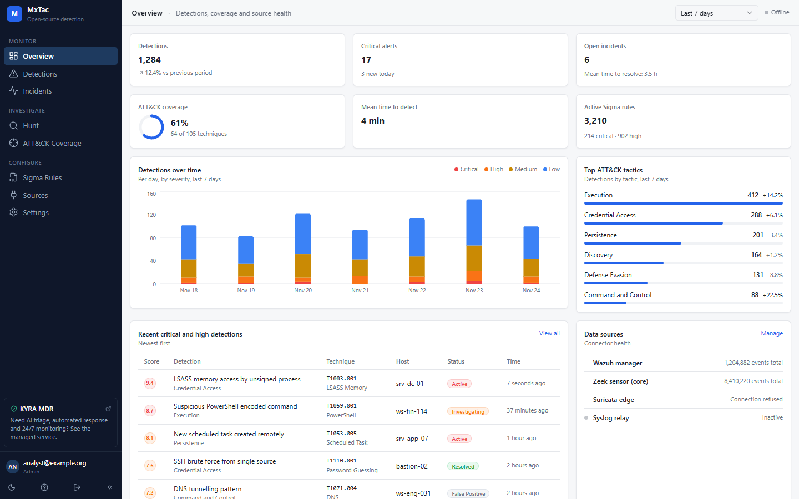
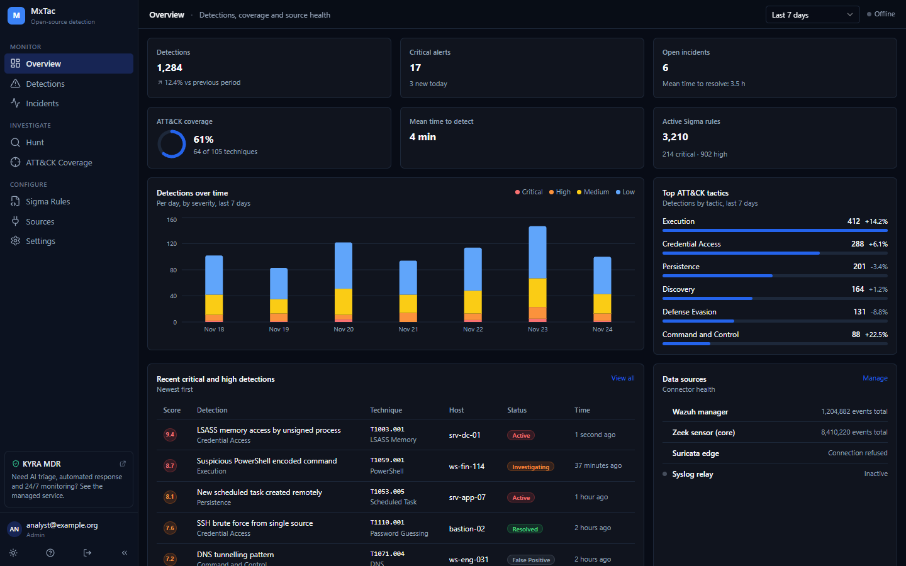
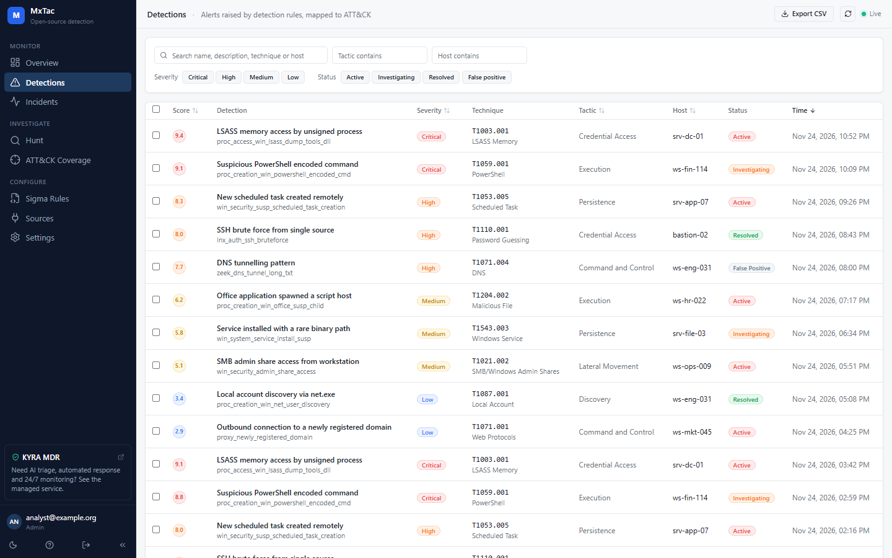
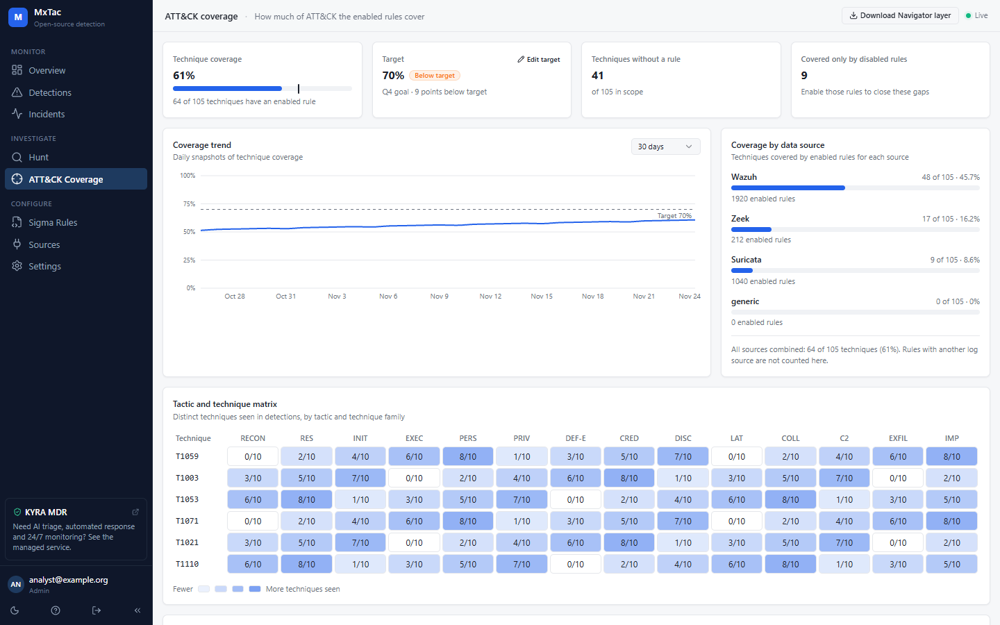

# MxTac

MxTac is an open-source detection platform built around MITRE ATT&CK. It collects security events from Wazuh, Zeek and Suricata, normalizes them to OCSF, evaluates Sigma rules against them, and shows the resulting detections, incidents and ATT&CK coverage in a web UI.

This repository is a deliberately small core. It is meant to be read, run and extended. The same company also operates a managed service, [KYRA MDR](https://kyramdr.com/en/?utm_source=mxtac&utm_medium=readme), which is a separate product. See [MxTac and KYRA MDR](#mxtac-and-kyra-mdr) for the difference.

## Features

| Area | What it does |
|------|--------------|
| Overview | KPI cards, detection timeline, top tactics, coverage heatmap, source status, recent detections |
| Detections | List, filter, sort, export to CSV, change status, assign, bulk update |
| Incidents | Create incidents, link detections, add notes, track status. High-severity detections on the same host and tactic are grouped into an incident automatically |
| Hunt | Search and aggregate stored events, view one event or one entity (IP, host, user, hash), export to CSV, save queries |
| ATT&CK Coverage | Coverage percentage from enabled Sigma rules, gaps, trend, per-source breakdown, ATT&CK Navigator layer export, coverage target |
| Sigma Rules | Create, edit, import (YAML), enable or disable, test a rule against a sample event, hot reload |
| Sources | Connectors for Wazuh, Zeek, Suricata, syslog and a generic webhook, with start, stop, test and health |
| Settings | Profile, TOTP MFA, user management (admin), light and dark theme |
| Access control | JWT login with optional TOTP MFA. Five roles: viewer, analyst, hunter, engineer, admin |

## Screenshots

| Overview (light) | Overview (dark) |
|------------------|-----------------|
|  |  |

| Detections | ATT&CK coverage |
|------------|-----------------|
|  |  |

## Quick start

You need Docker with Compose v2 and Git. The stack starts five containers: backend, frontend, PostgreSQL, Valkey and OpenSearch.

1. Clone the repository and start the stack.

   ```bash
   git clone https://github.com/fankh/mxtac.git
   cd mxtac/app
   docker compose up -d --build
   ```

   The backend container applies the database migrations (`alembic upgrade head`) before it starts the API.

2. Wait until the backend is ready. OpenSearch takes the longest to start.

   ```bash
   curl http://localhost:15000/ready
   ```

   The response contains `"status": "ready"` when PostgreSQL, Valkey and OpenSearch all answer.

3. Open the UI at <http://localhost:15001> and sign in (see [First login](#first-login)).

| Service | URL |
|---------|-----|
| Web UI | <http://localhost:15001> |
| API | <http://localhost:15000> |
| API reference (Swagger UI) | <http://localhost:15000/docs> |
| Prometheus metrics | <http://localhost:15000/metrics> |

Stop the stack with `docker compose down`. Add `-v` to delete the data volumes as well.

`app/docker-compose.yml` is a development setup: debug mode is on, the signing key and database password are fixed development values, OpenSearch runs without authentication, and every service port is published on the host. Use it on a trusted machine only. For anything else, read [docs/deployment.md](docs/deployment.md).

### First login

When the database has no users, the backend creates four accounts at startup. They are defined in `app/backend/app/db/seed.py`.

| Email | Role | Password |
|-------|------|----------|
| `admin@mxtac.local` | admin | `mxtac2026` |
| `engineer@mxtac.local` | engineer | `mxtac2026` |
| `hunter@mxtac.local` | hunter | `mxtac2026` |
| `analyst@mxtac.local` | analyst | `mxtac2026` |

These passwords are public. The backend does not force a change and has no endpoint for changing the password of an existing account. Before anyone else can reach the instance, replace the default accounts:

1. Request a token as `admin@mxtac.local` and create your own admin account with a password you choose.

   ```bash
   TOKEN=$(curl -s http://localhost:15000/api/v1/auth/login \
     -H 'Content-Type: application/json' \
     -d '{"email":"admin@mxtac.local","password":"mxtac2026"}' \
     | python3 -c 'import sys,json; print(json.load(sys.stdin)["access_token"])')

   curl -s http://localhost:15000/api/v1/users \
     -H "Authorization: Bearer $TOKEN" -H 'Content-Type: application/json' \
     -d '{"email":"you@example.com","full_name":"Your Name","role":"admin","password":"<your password>","must_change_password":false}'
   ```

   A password needs at least 8 characters and three of the four character types (upper case, lower case, digit, symbol).

2. Sign in to the UI with the new account.
3. Open **Settings**, select the **Users** tab, and deactivate the four default accounts.

### Optional services

| Profile | Command | Adds |
|---------|---------|------|
| `dashboards` | `docker compose --profile dashboards up -d` | OpenSearch Dashboards on <http://localhost:15006> |
| `monitoring` | `docker compose --profile monitoring up -d` | Prometheus on <http://localhost:15009> and Grafana on <http://localhost:15010>. The compose file sets the Grafana login to `admin` / `admin`; change it |
| `kafka` | `docker compose --profile kafka up -d` | A Redpanda broker on port 15007. The backend image does not include the Kafka client; see [ENV-REFERENCE.md](ENV-REFERENCE.md) |

## Architecture

```
                 +--------------------+
  browser -----> | frontend           |  React 18, Vite, Tailwind
                 | (port 15001)       |
                 +---------+----------+
                           | /api/v1 (REST), /api/v1/ws/alerts (WebSocket)
                           v
                 +--------------------+        +----------------------------+
  Wazuh API ---> | backend            | -----> | PostgreSQL 16              |
  Zeek logs ---> | FastAPI            |        | users, rules, detections,  |
  Suricata  ---> | (port 15000)       |        | incidents, connectors,     |
  EVE JSON       |                    |        | events                     |
                 |  connectors        |        +----------------------------+
                 |  -> normalizers    | -----> | Valkey 8                   |
                 |  -> Sigma engine   |        | rate limits, lockout,      |
                 |  -> alert manager  |        | dedup, live alert fan-out  |
                 |                    |        +----------------------------+
                 |                    | -----> | OpenSearch 2.17            |
                 +--------------------+        | event index for Hunt       |
                                               +----------------------------+
```

Inside the backend, an event moves through these steps:

1. A connector reads a raw event and publishes it to a queue topic. The queue is in-memory by default; Valkey Streams and Kafka are optional.
2. The normalizer converts Wazuh, Zeek and Suricata events to OCSF.
3. The event persister writes the normalized event to PostgreSQL and OpenSearch.
4. The Sigma engine evaluates enabled rules against the event.
5. The alert manager drops duplicates (same rule and host within 5 minutes), scores the alert, stores it as a detection, and may open or extend an incident.
6. The detection is pushed to connected browsers over a WebSocket.

More detail: [docs/architecture.md](docs/architecture.md).

## Configuration

The backend reads its settings from environment variables or `app/backend/.env`. [ENV-REFERENCE.md](ENV-REFERENCE.md) lists every setting. `app/backend/.env.example` is a starting point.

## Development

Backend (Python 3.12):

```bash
cd app/backend
python -m venv .venv && source .venv/bin/activate
pip install -e ".[dev]"
uvicorn app.main:app --reload --port 8080
pytest
ruff check .
```

Frontend (Node.js 20 or newer):

```bash
cd app/frontend
npm ci
npm run dev        # Vite dev server on port 5173
npm test           # Vitest
npm run lint
npm run build
```

See [docs/development.md](docs/development.md) for the database, the dev proxy and the test setup.

## Documentation

| Document | Content |
|----------|---------|
| [INSTALL.md](INSTALL.md) | Installation and upgrade steps |
| [ENV-REFERENCE.md](ENV-REFERENCE.md) | Environment variables |
| [docs/architecture.md](docs/architecture.md) | Components and the event pipeline |
| [docs/api.md](docs/api.md) | REST API routes and required permissions |
| [docs/sigma-engine.md](docs/sigma-engine.md) | Supported Sigma features |
| [docs/attack-coverage.md](docs/attack-coverage.md) | How coverage is calculated |
| [docs/integration-guide.md](docs/integration-guide.md) | Connecting Wazuh, Zeek, Suricata, syslog and webhooks |
| [docs/ui.md](docs/ui.md) | Pages and the UI token system |
| [docs/security.md](docs/security.md) | Authentication, roles, password policy, headers |
| [docs/deployment.md](docs/deployment.md) | Deployment files in this repository |
| [docs/development.md](docs/development.md) | Development workflow |

## MxTac and KYRA MDR

MxTac is the open-source detection core. KYRA MDR is a managed detection and response service from the same company. The table lists what each one covers.

| Capability | MxTac (this repository) | KYRA MDR (managed service) |
|------------|-------------------------|----------------------------|
| Sigma rule detection with ATT&CK mapping | Yes | Yes |
| Detections, incidents, event search, coverage views | Yes | Yes |
| Operation | You install and run it | Run for you, with 24/7 monitoring by analysts |
| AI triage and investigation | No | Yes |
| Automated response | No | Yes |
| Threat intelligence | No | Yes |
| Compliance reporting | No | Yes |
| EDR and NDR agents | No | Yes |
| Single sign-on (SSO) | No | Yes |

More about the managed service: <https://kyramdr.com/en/?utm_source=mxtac&utm_medium=readme>

## Current limitations

- **Syslog and webhook events are not processed.** The syslog listener and the generic webhook endpoint accept events and publish them to the queue, but there is no normalizer for them yet. They are not stored, not searchable in Hunt, and not evaluated by Sigma rules. Only Wazuh, Zeek and Suricata events reach detection.
- **Default accounts.** A new database gets four accounts with a published password. See [First login](#first-login).
- **No password change for existing accounts.** A password can only be set when the account is created or during the forced change at first sign-in.
- **The live alert WebSocket does not check the token.** Anyone who can reach `/api/v1/ws/alerts` receives new detections. Restrict network access to the API.
- **Sigma support is a subset.** Field modifiers and boolean conditions work. Aggregations, correlation rules and time frames do not. See [docs/sigma-engine.md](docs/sigma-engine.md).
- **Coverage uses a fixed scope** of 105 techniques across 9 tactics, not the full ATT&CK matrix. See [docs/attack-coverage.md](docs/attack-coverage.md).
- **Five example rules are included.** Import your own rules to cover more techniques.
- **Email invites are incomplete.** `POST /api/v1/users/invite` creates the account and sends a link, but the page that link points to does not exist. Use **Add user** instead.

## License

MxTac is licensed under the GNU Affero General Public License v3.0. See [LICENSE](LICENSE).

## Contributing and security

- Contributions: [CONTRIBUTING.md](CONTRIBUTING.md)
- Reporting a vulnerability: [SECURITY.md](SECURITY.md)
- Release notes: [CHANGELOG.md](CHANGELOG.md)
